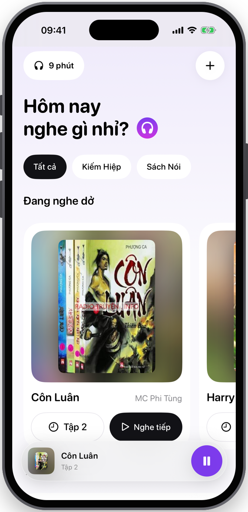
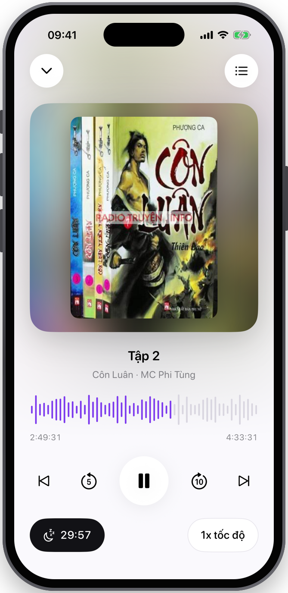
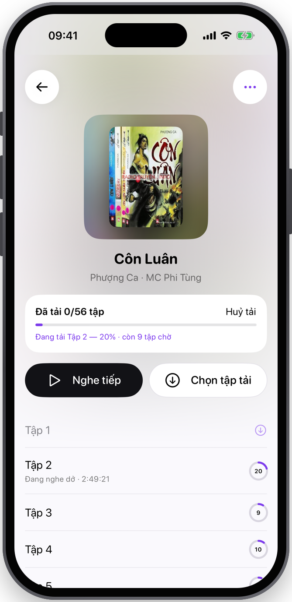
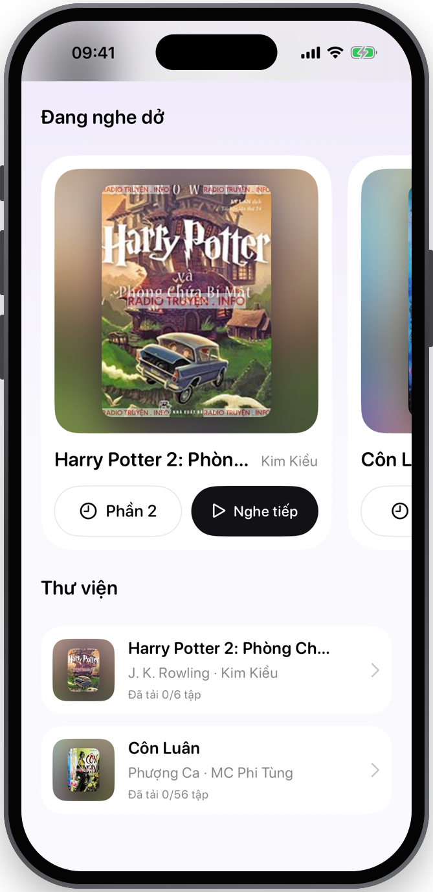
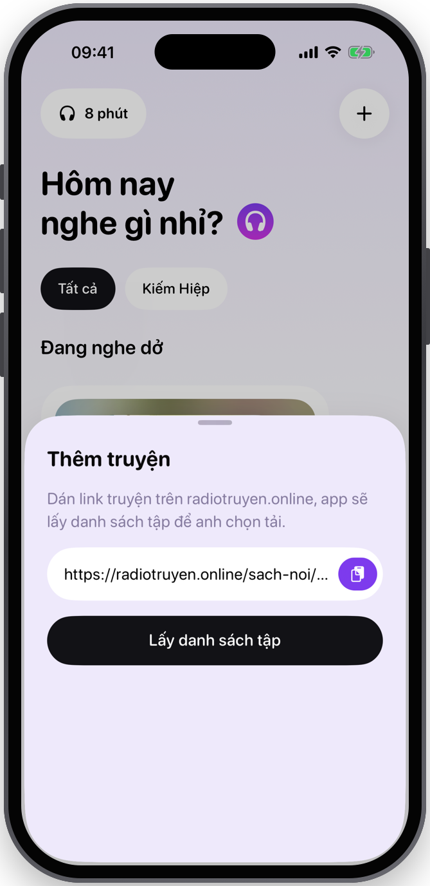
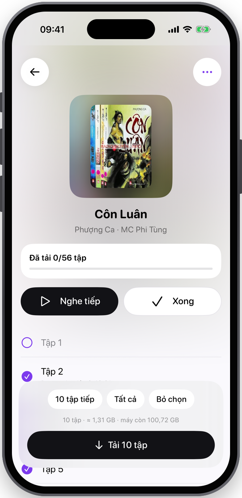
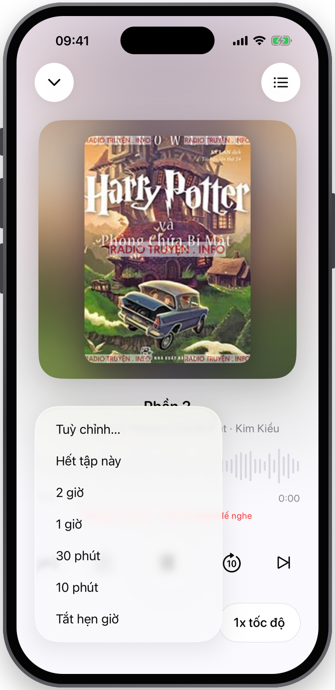

<p align="center">
  
</p>

<h1 align="center">Earshelf</h1>

<p align="center">
  A personal, offline-first audiobook player for iPhone.<br/>
  Paste a link from <a href="https://radiotruyen.online">radiotruyen.online</a>, pick the episodes you want, listen anywhere — no network needed.
</p>

<p align="center">
  
  
  
  
</p>

<p align="center">
  
  &nbsp;
  
  &nbsp;
  
</p>

---

## Why

radiotruyen.online has a huge catalogue of Vietnamese audio stories, but the site is ad-heavy, needs a connection the whole time, and forgets where you were. Earshelf turns any story page into a clean, local audiobook on your phone.

## Features

- **Import from a link** — paste a radiotruyen.online story URL; the app fetches the title, author, narrator, cover and the full episode list.
- **Download in batches** — tick the episodes you want (or tap *Next 10*). The app estimates the size against free space before you start.
- **Live download status** — overall progress, the episode currently downloading with its %, and how many are queued. Downloads keep going in the background and survive app restarts.
- **Resume anywhere** — position is saved every few seconds, on pause and when the app goes to the background. *Continue listening* cards on the home screen take you back to the exact second.
- **Sleep timer** — 10 min, 30 min, 1 h, 2 h, end of episode, or a custom duration. Volume fades out over the last 10 seconds.
- **2h15 safety stop** — playback stops automatically after 2 hours 15 minutes without any interaction (play / pause / seek / change episode resets the clock).
- **Player essentials** — skip back 5s / forward 10s, previous / next episode, speed 0.75×–2×, auto-advance to the next episode, lock-screen & headphone controls.
- **Storage housekeeping** — swipe to delete a single file, or delete every finished episode of a book in one go. Downloads are excluded from iCloud backup.
- **Library** — genre filter chips, multiple books, blurred-cover artwork, light & dark mode.

## Screenshots

| Home | Library | Add a story |
|:---:|:---:|:---:|
|  |  |  |
| **Pick episodes** | **Downloading** | **Sleep timer** |
|  |  |  |

## How the import works

The episode list on radiotruyen.online is not in the HTML: it ships as an AES-encrypted blob that an obfuscated script decrypts in the browser before handing it to jPlayer. Instead of reverse-engineering the key, Earshelf lets the page decrypt itself:

1. The story page is loaded in a hidden `WKWebView`, with images, fonts and ad/analytics hosts blocked by a content rule list so it loads fast.
2. A user script injected at document start replaces `window.jPlayerPlaylist` with a stub that posts the decrypted `[{title, mp3}]` list back to Swift, and neutralises the site's devtools detector (`randomewave`), which otherwise removes the player.
3. Metadata (title, author, narrator, genre, cover) comes from the page's `ld+json` and markup.

Because it relies on the site's own decryption, a key rotation on the site doesn't break it. Re-importing a story (*⋯ → Update episodes*) only appends new episodes, so ongoing series stay in sync.

> Only radiotruyen.online is supported. Other sites would need their own scraper.

## Tech stack

- **SwiftUI** for the UI, **SwiftData** for the library and playback state
- **AVPlayer** + `MPNowPlayingInfoCenter` / `MPRemoteCommandCenter` for playback and lock-screen controls
- **Background `URLSession`** for downloads
- **WebKit** for the import
- No third-party dependencies

## Project structure

```
Earshelf/
├── EarshelfApp.swift      App entry, model container, background-download hook
├── Models.swift           Book / Episode (SwiftData)
├── RadioTruyen.swift      WKWebView scraper + library import/delete
├── Downloader.swift       Background downloads, progress, size estimate
├── Player.swift           AVPlayer wrapper: resume, sleep timer, 2h15 stop, remote commands
├── HomeView.swift         Home, library, add-link sheet
├── BookView.swift         Episode list, batch selection, storage actions
├── PlayerView.swift       Full-screen player, waveform, custom timer, mini player
└── Theme.swift            Colors, covers, shared components
docs/
├── frame.swift            Wraps simulator screenshots in an iPhone bezel
└── screenshots/
```

## Build & run

Requirements: a Mac with **Xcode 26 or later** and an iPhone on **iOS 17 or later**.

```bash
git clone https://github.com/winter2897/earshelf.git
open earshelf/Earshelf.xcodeproj
```

**Simulator:** pick an iPhone simulator and press **Run** (⌘R).

**Your own iPhone (free Apple ID works):**

1. In Xcode, open **Settings → Accounts** and add your Apple ID.
2. Create `Local.xcconfig` next to `Config.xcconfig` with your team id (find it in Xcode → Settings → Accounts):
   ```
   DEVELOPMENT_TEAM = ABCDE12345
   ```
   It is git-ignored, so your team never ends up in the repo. If the bundle id is taken, change `PRODUCT_BUNDLE_IDENTIFIER` to something unique.
3. On the iPhone, turn on **Settings → Privacy & Security → Developer Mode** and restart when asked.
4. Connect the phone, select it as the run destination, and press **Run**.
5. The first time, trust your developer profile under **Settings → General → VPN & Device Management**.

With a free Apple ID the app stays signed for 7 days. Re-run from Xcode to renew it; downloaded books and listening progress are kept.

## Notes

- An episode on radiotruyen.online is often 2–4+ hours and over 100 MB, which is why downloads are picked in batches.
- Episodes that aren't downloaded yet can still be streamed when you're online.
- If the site's file host is down, downloads fail with a retry option and streaming shows a clear error. Nothing is lost locally.

## Disclaimer

Earshelf is a personal project for listening offline to content you can already access for free on radiotruyen.online. It is not affiliated with that site. Please respect the rights of the content owners, and don't redistribute downloaded audio.

## License

[GNU AGPL-3.0](LICENSE)
